<!-- Generated by scripts/build_all.py from scripts/README.template.md. Edit the template, not this file. -->

<a href="https://www.manavaghera.dev">
  <picture><source media="(prefers-color-scheme: light)" srcset="assets/light/hero.svg" /></picture>
</a>

 

<a href="https://www.manavaghera.dev"><picture>
  <source media="(prefers-color-scheme: light)" srcset="https://readme-typing-svg.demolab.com?font=JetBrains+Mono&weight=600&size=22&duration=2600&pause=900&color=000000&center=true&vCenter=true&width=720&lines=I+build+AI+that+shows+its+work.;RAG+systems+that+cite+their+sources.;Autonomous+agents+%E2%80%94+Kaggle+top+1%25.;Model+Context+Protocol+%C2%B7+evals+%C2%B7+quant." />
  
</picture></a>

  

<a href="https://www.manavaghera.dev"><picture><source media="(prefers-color-scheme: light)" srcset="https://img.shields.io/badge/portfolio-manavaghera.dev-000000?style=for-the-badge&logo=googlechrome&logoColor=f2ede4&labelColor=302f2e" /></picture></a>
<a href="https://www.linkedin.com/in/manav-aghera"><picture><source media="(prefers-color-scheme: light)" srcset="https://img.shields.io/badge/linkedin-manav--aghera-000000?style=for-the-badge&logo=linkedin&logoColor=f2ede4&labelColor=302f2e" /></picture></a>
<a href="mailto:manavaghera@yahoo.com"><picture><source media="(prefers-color-scheme: light)" srcset="https://img.shields.io/badge/email-say%20hello-000000?style=for-the-badge&logo=maildotru&logoColor=f2ede4&labelColor=302f2e" /></picture></a>
<picture><source media="(prefers-color-scheme: light)" srcset="https://komarev.com/ghpvc/?username=manavaghera&style=for-the-badge&color=000000&label=PROFILE+VIEWS" /></picture>

<picture><source media="(prefers-color-scheme: light)" srcset="assets/light/divider.svg" /></picture>

<picture><source media="(prefers-color-scheme: light)" srcset="assets/light/terminal.svg" /></picture>

<picture><source media="(prefers-color-scheme: light)" srcset="assets/light/divider.svg" /></picture>

<h2 align="center">Featured builds</h2>

  <a href="https://github.com/manavaghera/CHRONUS"><picture><source media="(prefers-color-scheme: light)" srcset="assets/light/cards/chronus.svg" /></picture></a>
  <a href="https://github.com/manavaghera/LLM-NEWS-"><picture><source media="(prefers-color-scheme: light)" srcset="assets/light/cards/newssense.svg" /></picture></a>
  <a href="https://github.com/manavaghera/Autonomous-Agent-Kaggle"><picture><source media="(prefers-color-scheme: light)" srcset="assets/light/cards/kaggle-agent.svg" /></picture></a>
  <a href="https://github.com/manavaghera/Twitch-Bulk-Downloader"><picture><source media="(prefers-color-scheme: light)" srcset="assets/light/cards/clip-studio.svg" /></picture></a>
  <a href="https://github.com/manavaghera/Multi-agent-blog"><picture><source media="(prefers-color-scheme: light)" srcset="assets/light/cards/autonomous-content.svg" /></picture></a>
  <a href="https://github.com/manavaghera/mcp-demo"><picture><source media="(prefers-color-scheme: light)" srcset="assets/light/cards/mcp-demo.svg" /></picture></a>

<picture><source media="(prefers-color-scheme: light)" srcset="assets/light/divider.svg" /></picture>

<picture><source media="(prefers-color-scheme: light)" srcset="assets/light/timeline.svg" /></picture>

<picture><source media="(prefers-color-scheme: light)" srcset="assets/light/divider.svg" /></picture>

<h2 align="center">Arsenal</h2>

<picture><source media="(prefers-color-scheme: light)" srcset="assets/light/ai-tools.svg" /></picture>

  

<table>
  <tr>
    <td align="center"><b>LANGUAGES</b> <picture><source media="(prefers-color-scheme: light)" srcset="https://skillicons.dev/icons?i=py,java,ts,js,rust,bash,powershell&theme=light" /></picture></td>
    <td align="center"><b>AI / ML</b> <picture><source media="(prefers-color-scheme: light)" srcset="https://skillicons.dev/icons?i=pytorch,sklearn,anaconda&theme=light" /></picture></td>
  </tr>
  <tr>
    <td align="center"><b>BACKEND &amp; DATA</b> <picture><source media="(prefers-color-scheme: light)" srcset="https://skillicons.dev/icons?i=fastapi,nodejs,bun,mongodb,docker&theme=light" /></picture></td>
    <td align="center"><b>FRONTEND</b> <picture><source media="(prefers-color-scheme: light)" srcset="https://skillicons.dev/icons?i=react,vite,tailwind,html,css&theme=light" /></picture></td>
  </tr>
  <tr>
    <td align="center" colspan="2"><b>TOOLING</b> <picture><source media="(prefers-color-scheme: light)" srcset="https://skillicons.dev/icons?i=git,github,githubactions,vercel,vscode,idea,androidstudio,windows&theme=light" /></picture></td>
  </tr>
</table>

<picture><source media="(prefers-color-scheme: light)" srcset="assets/light/divider.svg" /></picture>

<picture><source media="(prefers-color-scheme: light)" srcset="assets/light/generated/tokens.svg" /></picture>

  

<picture><source media="(prefers-color-scheme: light)" srcset="assets/light/generated/stats.svg" /></picture>

  

<a href="https://www.manavaghera.dev"><picture><source media="(prefers-color-scheme: light)" srcset="assets/light/footer.svg" /></picture></a>

Every graphic here is hand-built SVG, no GIFs. Stats refresh every 6 hours via <a href=".github/workflows/profile.yml">GitHub Actions</a>.

