 

  

<h2 align="center">Featured builds</h2>

  
  
  
  
  
  

<h2 align="center">Arsenal</h2>

**AI / ML** 

**Backend & data** 

**Frontend** 

**Tooling** 

  

<picture>
  <source media="(prefers-color-scheme: dark)" srcset="https://raw.githubusercontent.com/manavaghera/manavaghera/output/snake-dark.svg" />
  <source media="(prefers-color-scheme: light)" srcset="https://raw.githubusercontent.com/manavaghera/manavaghera/output/snake-light.svg" />
  
</picture>

  

Every graphic here is hand-built SVG, no GIFs. Stats and the snake refresh every 6 hours via <a href=".github/workflows/profile.yml">GitHub Actions</a>.

